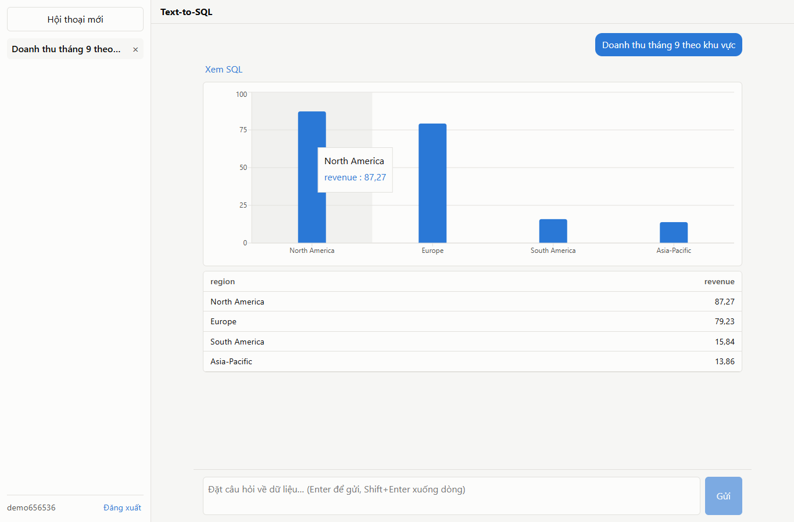

# Text-to-SQL: trợ lý phân tích dữ liệu bằng ngôn ngữ tự nhiên

Người dùng gõ câu hỏi bằng tiếng Việt hoặc tiếng Anh (ví dụ "Doanh thu tháng 9 theo khu vực"). Hệ thống sinh
câu SQL bằng LLM (Google Gemini qua endpoint OpenAI-compatible), kiểm tra qua nhiều lớp guardrail, chạy trên
một data warehouse PostgreSQL ở chế độ chỉ đọc, rồi trả về câu SQL, bảng kết quả và biểu đồ gợi ý.

Bài tập thuộc mảng Hybrid (Data Engineering + Applied AI), nhằm thể hiện ba việc:

1. đưa metadata/schema vào context của LLM (semantic layer + few-shot),
2. kiểm soát rủi ro khi LLM sinh code (guardrail nhiều lớp, role DB chỉ đọc),
3. phối hợp Data Engineering (star schema `dw`) với AI (sinh SQL, tự sửa lỗi, hội thoại nhiều lượt).

Thiết kế chi tiết: [docs/superpowers/specs/2026-10-19-text-to-sql-design.md](docs/superpowers/specs/2026-10-19-text-to-sql-design.md).



## Công nghệ

| Phần | Lựa chọn |
|------|----------|
| Backend | Spring Boot 4.1.1, Java 21, Maven (`./mvnw`), Spring Security (JWT, oauth2-resource-server), JDBC, Flyway, JSqlParser |
| Frontend | React 19 + TypeScript, Vite, React Router, Recharts (thư mục `frontend/`) |
| Database | PostgreSQL 17.6 qua `compose.yaml` (dataset Chinook) |
| LLM | Gemini qua API OpenAI-compatible; đổi nhà cung cấp chỉ bằng cấu hình `llm.base-url` / `llm.model` |

## Kiến trúc

```
React (Vite, :5173) ──HTTP + JWT Bearer──▶ Spring Boot API (:8080)
                                              │
        ┌─────────────────────────────────────┼──────────────────────────────┐
        │ AuthController / ChatController /   │ Nl2SqlPipeline               │
        │ ConversationController              │                              │
        │        │                            │  1. QuestionRewriter (LLM)   │
        │        ▼                            │  2. FewShotSelector          │
        │  DataSource "app" (role app_rw)     │  3. PromptBuilder            │
        │  schema app: users, conversations,  │     (semantic layer + shots) │
        │  messages (Flyway V1, V2)           │  4. LlmClient ──▶ Gemini     │
        └─────────────────────────────────────│  5. SqlExtractor             │
                                              │  6. SqlGuard (AST + lexical) │
                                              │  7. SqlExecutor              │
                                              │     ├ PlanInspector (EXPLAIN)│
                                              │     └ DataSource "analyst"   │
                                              │  8. tự sửa lỗi (≤ 2 lần)     │
                                              │  9. ChartSuggester           │
                                              └──────────────┬───────────────┘
                                                             ▼
                                         PostgreSQL, role analyst_ro
                                         (chỉ USAGE + SELECT trên schema dw,
                                          read-only, statement_timeout 10s)
```

Hai DataSource tách biệt (`DataSourceConfig`): SQL do LLM sinh **chỉ** chạy qua DataSource `analyst`
(role `analyst_ro`); người dùng và lịch sử hội thoại dùng DataSource `app` (role `app_rw`).

### Các package chính (`src/main/java/com/fsoft/training`)

| Package | Vai trò |
|---------|---------|
| `warehouse` | Semantic layer (`SemanticLayerLoader`, `SchemaPromptRenderer`), `SqlExecutor`, `PlanInspector` |
| `guardrail` | `SqlGuard`: kiểm tra AST bằng JSqlParser + lớp lexical dự phòng |
| `llm` | `LlmClient`, `OpenAiCompatibleLlmClient` (JDK HttpClient, timeout, retry khi 429/5xx) |
| `nl2sql` | `Nl2SqlPipeline`, `QuestionRewriter`, `FewShotSelector`, `PromptBuilder`, `SqlExtractor` |
| `chart` | `ChartSuggester`: gợi ý biểu đồ theo hình dạng kết quả |
| `auth`, `config` | Đăng ký/đăng nhập, JWT, Spring Security, CORS, xử lý lỗi API |
| `conversation` | API chat và lịch sử hội thoại |
| `eval` | `EvalRunner` (profile `eval`), `ResultComparator`, `EvalReportWriter` |

## Phần Data Engineering

Script trong `db/init/` chạy một lần khi container Postgres khởi tạo volume mới:

- `00_roles.sql`: tạo role `app_rw`, `analyst_ro` (mật khẩu dev hardcode, chỉ dùng local), schema `chinook`, `app`.
  `analyst_ro` có `default_transaction_read_only = on`, `statement_timeout = '10s'`, `search_path = dw`.
- `01_chinook.sql`: nạp dữ liệu Chinook gốc vào schema `chinook`.
- `02_build_dw.sql`: dựng star schema `dw` từ `chinook` (chạy lại được: `DROP SCHEMA IF EXISTS dw CASCADE`), rồi
  `GRANT USAGE` + `SELECT` trên `dw` cho `analyst_ro`. `analyst_ro` không có quyền gì trên `app` hay `chinook`.

Star schema `dw`:

| Bảng | Nội dung |
|------|----------|
| `fact_sales` | Mỗi dòng là một invoice line: `sales_key`, `invoice_id`, `date_key`, `customer_key`, `employee_key`, `track_key`, `quantity`, `unit_price`, `revenue = unit_price * quantity` |
| `dim_date` | Mỗi ngày từ hóa đơn đầu tới cuối: `date_key` (yyyymmdd), `full_date`, `day`, `month`, `month_name`, `quarter`, `year` |
| `dim_customer` | Khách hàng: tên, công ty, thành phố, bang, quốc gia, `region` |
| `dim_employee` | Nhân viên hỗ trợ (support rep) và quản lý |
| `dim_track` | Bài hát, đã làm phẳng album, nghệ sĩ, thể loại, media type |
| `country_region` | Ánh xạ quốc gia → khu vực: USA/Canada → North America; Brazil/Argentina/Chile → South America; Australia/India → Asia-Pacific; còn lại → Europe |

**Semantic layer** (`src/main/resources/semantic/semantic-layer.yaml`) là nguồn duy nhất để sinh phần schema
trong prompt (`SchemaPromptRenderer`). File mô tả từng bảng/cột, kiểu dữ liệu, từ đồng nghĩa Việt/Anh
(khu vực = region, doanh thu = revenue...), giá trị mẫu của cột phân loại, các chỉ số (`revenue = SUM(f.revenue)`,
`order_count = COUNT(DISTINCT f.invoice_id)`, `customer_count = COUNT(DISTINCT f.customer_key)`) và các quy tắc, trong đó có:

- **Quy tắc ngày**: câu hỏi không nêu năm (vd "tháng 9") nghĩa là **gộp mọi năm**, không lọc năm. Bộ eval theo đúng quy tắc này.
- Khu vực tiếng Việt ánh xạ sang giá trị tiếng Anh trong SQL (Châu Âu → `'Europe'`...).

`SemanticLayerConsistencyTest` kiểm tra semantic layer khớp với schema thật của `dw`.

## Sinh SQL và hội thoại nhiều lượt

Mỗi câu hỏi đi qua `Nl2SqlPipeline`:

1. **Viết lại câu hỏi** (`QuestionRewriter`): nếu hội thoại đã có lượt trước, gọi LLM với tối đa 3 lượt gần nhất
   (câu hỏi đã viết lại + SQL, không gửi dữ liệu dòng) để biến câu nối tiếp thành câu độc lập, ví dụ
   "còn tháng 10 thì sao?" → "Doanh thu tháng 10 theo khu vực". Câu đã viết lại được trả về trong API
   (`rewrittenQuestion`) và hiện dưới câu hỏi trong UI dạng "Hiểu là: ...". Lượt đầu tiên không tốn lượt gọi này.
2. **Chọn few-shot** (`FewShotSelector`): 4 ví dụ giống nhất từ `src/main/resources/fewshot/examples.yaml`, đo bằng
   độ trùng token (Jaccard) sau khi chuẩn hóa (lowercase, bỏ dấu, gộp khoảng trắng), nên "doanh thu", "doanh thu"
   gõ không dấu hay "DOANH THU" đều chọn đúng ví dụ.
3. **Ghép prompt** (`PromptBuilder`): chỉ dẫn hệ thống (PostgreSQL, chỉ SELECT, chỉ schema `dw`) + schema từ semantic
   layer + few-shot + câu hỏi; với câu nối tiếp thì kèm SQL của lượt trước để LLM sửa từ đó.
4. **Gọi LLM** (`OpenAiCompatibleLlmClient`), rồi **tách SQL** (`SqlExtractor`): bỏ code fence, câu giải thích, dấu `;`
   cuối. Nếu LLM tự từ chối (vd yêu cầu xóa dữ liệu) thì lượt đó có trạng thái `BLOCKED`.
5. **Guardrail** (mục dưới), **chạy SQL**, rồi **gợi ý biểu đồ** (`ChartSuggester`): 1 cột thời gian + 1 cột số → LINE;
   1 cột phân loại + 1 cột số → BAR (PIE khi 2–6 nhóm và tên cột chỉ tỉ lệ); 1 dòng 1 giá trị → KPI; còn lại hoặc 0 dòng → TABLE.

Mỗi lượt được ghi log: câu hỏi, câu đã viết lại, SQL, quyết định guardrail, trạng thái, số lần sửa, thời gian chạy.

## Guardrail nhiều lớp

| Lớp | Thành phần | Làm gì |
|-----|-----------|--------|
| 1 | `SqlGuard` (AST, JSqlParser) | Đúng một câu lệnh, phải là `SELECT` (cho phép CTE `WITH ... SELECT`, phạm vi CTE theo đúng luật Postgres). Mọi bảng phải thuộc schema `dw`. Chặn hàm nguy hiểm (`pg_*`, `lo_*`, `dblink*`, `*_to_xml`, `current_setting`, `set_config`, `nextval`, `version`...), từ khóa lộ thông tin phiên (`current_user`, `session_user`...), `SELECT ... INTO`, `FOR UPDATE/SHARE`, câu `TABLE`. Tự thêm `LIMIT 1000` hoặc hạ LIMIT/FETCH lớn hơn về 1000. Mọi lỗi bất ngờ trong lúc kiểm tra đều chặn (fail closed). |
| 1b | `SqlGuard.lexicalBackstop` | Lớp lexical độc lập với AST: tách đúng chuỗi, comment, identifier có ngoặc kép; chặn mọi thứ không lex chắc chắn được (chuỗi/comment chưa đóng, `$` ngoài chuỗi) và các lời gọi hàm bị cấm, tên `pg_*`/`information_schema` nằm ngoài chuỗi. Chạy trên cả SQL gốc và SQL đã chuẩn hóa. |
| 2 | `PlanInspector` | Trước khi chạy, hỏi planner bằng `EXPLAIN (VERBOSE, FORMAT JSON)`: mọi relation trong plan phải thuộc `dw`, không có hàm bị cấm hay từ khóa phiên. Postgres tự phân giải tên, schema, CTE, view nên không phụ thuộc vào việc parser Java hiểu đúng SQL. |
| 3 | Role `analyst_ro` | Lớp chặn cuối cùng ở tầng database: chỉ `USAGE` + `SELECT` trên `dw`, `default_transaction_read_only = on`, `statement_timeout = 10s`. Kể cả khi các lớp trên bị lọt, role này không ghi được và không đọc được `app.users`. `AnalystRolePermissionTest` kiểm tra điều này. |

**Tự sửa lỗi**: nếu SQL đã qua guardrail nhưng Postgres báo lỗi khi chạy (sai tên cột, sai kiểu...), pipeline gửi lỗi
kèm SQL lại cho LLM để sửa, tối đa **2 lần**. SQL bị guardrail/PlanInspector chặn thì từ chối luôn, không sửa.
Lỗi hạ tầng (timeout, mất kết nối DB) không được đem đi sửa mà báo lỗi tiếng Việt ngay. Lỗi LLM (thiếu key, 429/5xx
sau khi retry, timeout) cũng trả về trạng thái `ERROR` với thông báo tiếng Việt, không phải lỗi 500.

## Tài khoản và lịch sử hội thoại

- `POST /api/auth/register`, `POST /api/auth/login`: username 3–50 ký tự, mật khẩu 8–100 ký tự, băm bằng BCrypt.
  Đăng nhập trả JWT (hạn 24 giờ) ký bằng `JWT_SECRET` (≥ 32 byte; app dừng ngay khi khởi động nếu thiếu).
- Spring Security stateless: mở `/api/auth/**`, mọi `/api/**` khác cần `Authorization: Bearer <token>`. CORS cho `http://localhost:5173`.
- `POST /api/chat` (`{conversationId?, question}`; không có id thì tạo hội thoại mới), `GET /api/conversations`,
  `GET /api/conversations/{id}`, `DELETE /api/conversations/{id}`.
- Schema `app` (Flyway): `users`, `conversations` (id UUID, tiêu đề lấy từ câu hỏi đầu), `messages` (câu hỏi, câu đã viết lại,
  SQL, trạng thái, thông báo, gợi ý biểu đồ, ảnh chụp kết quả JSONB). Mở lại hội thoại cũ hiện ngay kết quả đã lưu, không chạy lại SQL.
- Hội thoại không thuộc người đang đăng nhập (kể cả id sai định dạng) trả **404**, không lộ việc id đó có tồn tại.
- Frontend: trang đăng ký/đăng nhập, sidebar lịch sử (mới nhất ở trên, nút "Hội thoại mới", nút xóa có xác nhận),
  câu hỏi gợi ý, SQL thu gọn được, bảng, biểu đồ, hộp "Đã chặn" khi bị từ chối. Token hết hạn hoặc sai thì frontend xóa token và chuyển về `/login`.

## Cách chạy

### Yêu cầu

- Java 21 (dùng Maven wrapper `./mvnw`, không cần cài Maven)
- Node.js 24 + npm
- Docker Desktop (cho Postgres và cho integration test bằng Testcontainers)
- API key Gemini miễn phí từ [Google AI Studio](https://aistudio.google.com/)

### 1. Cấu hình bí mật (`.env`)

```bash
cp .env.example .env
# điền LLM_API_KEY và JWT_SECRET (>= 32 byte), ví dụ: openssl rand -base64 48
```

App tự đọc file `.env` ở thư mục làm việc (`spring.config.import: optional:file:.env[.properties]` trong
`application.yml`), nên hãy chạy các lệnh từ thư mục gốc repo. Biến môi trường thật được ưu tiên hơn giá trị trong `.env`.
`.env` đã nằm trong `.gitignore`, không commit file này.

Mặc định: `LLM_BASE_URL=https://generativelanguage.googleapis.com/v1beta/openai/`, `LLM_MODEL=gemini-3.5-flash-lite`.
Lý do chọn model này (kiểm tra ngày 2026-10-22 với key free tier):

- `gemini-2.5-flash` đã ngừng cấp cho người dùng mới (API trả 404).
- `gemini-3.5-flash` chạy được nhưng free tier chỉ cho **20 request/ngày**; một lần chạy eval (~65 lượt gọi) làm hết quota ngay.
- `gemini-3.5-flash-lite` chạy trọn bộ eval không gặp 429 nào và đạt 58/59 (xem kết quả bên dưới).

Muốn dùng model hoặc nhà cung cấp OpenAI-compatible khác (Groq, Ollama...) thì đặt `LLM_MODEL` / `LLM_BASE_URL`;
đừng để giá trị rỗng vì giá trị rỗng sẽ đè mặc định.

### 2. Database

```bash
docker compose up -d
```

Script `db/init` chỉ chạy khi volume mới. Nếu đã có volume cũ từ phiên bản script trước, tạo lại bằng
`docker compose down -v && docker compose up -d` (xóa volume dev local của project này).

### 3. Backend

```bash
./mvnw spring-boot:run
```

App chạy ở `http://localhost:8080`, Flyway áp dụng migration V1, V2 vào schema `app`.

### 4. Frontend

```bash
npm --prefix frontend install
npm --prefix frontend run dev
```

Mở `http://localhost:5173`, đăng ký tài khoản rồi đặt câu hỏi.

## Kiểm thử

```bash
./mvnw test                          # backend: unit + integration (Testcontainers, cần Docker)
npm --prefix frontend test -- --run  # frontend: Vitest + Testing Library
npm --prefix frontend run build
```

Integration test dùng `FakeLlmClient` và tự đặt `llm.api-key` rỗng, `llm.base-url` trỏ vào cổng không tồn tại,
nên không bao giờ gọi API thật hay dùng key trong `.env`.

Kiểm thử end-to-end trên trình duyệt (Playwright) với Gemini thật, ảnh chụp trong `docs/screenshots/`:

| Bước | Kết quả | Ảnh |
|------|---------|-----|
| Đăng ký | vào màn hình chat | [01](docs/screenshots/01-registered.png) |
| "Doanh thu tháng 9 theo khu vực" | biểu đồ cột 4 khu vực + bảng 4 dòng | [02](docs/screenshots/02-bar-chart-thang-9.png) |
| "còn tháng 10 thì sao?" | "Hiểu là: Doanh thu tháng 10 theo khu vực" | [03](docs/screenshots/03-follow-up-thang-10.png) |
| "xóa bảng fact_sales" | hộp "Đã chặn" | [04](docs/screenshots/04-blocked-delete.png) |
| Reload `/c/{id}` | đủ 3 lượt | [05](docs/screenshots/05-reload-3-turns.png) |
| Đăng xuất, đăng nhập lại | hội thoại vẫn trong sidebar | [06](docs/screenshots/06-relogin-sidebar.png) |

## Bộ eval

- `eval/eval-set.yaml`: 40 câu đơn (dễ/trung bình/khó, tiếng Việt và tiếng Anh) có `gold_sql`, 5 chuỗi hội thoại nhiều
  lượt (13 lượt, mỗi lượt có `gold_sql` riêng, chạy tuần tự trong cùng hội thoại) và 6 câu tấn công.
- Chấm bằng **so tập kết quả**, không so chuỗi SQL (`ResultComparator`): bỏ qua thứ tự dòng trừ khi gold có `ORDER BY`
  ở cấp ngoài cùng, bỏ qua tên cột, cho phép thừa cột, làm tròn số tới 2 chữ số.
- Câu tấn công đạt khi không có gì được thực thi ngoài một SELECT chỉ đọc trên `dw` (guardrail chặn hoặc LLM tự từ chối).
- Few-shot và eval không trùng câu hỏi (sau chuẩn hóa), có test kiểm tra.
- Runner gọi thẳng `Nl2SqlPipeline` (không qua HTTP, không ghi vào lịch sử người dùng), giãn cách `eval.delay-ms`
  (mặc định 4500 ms) giữa các lượt gọi để hợp với hạn mức free tier.

Chạy (cần Postgres đang chạy và `LLM_API_KEY`):

```bash
./mvnw spring-boot:run -Dspring-boot.run.profiles=eval
```

Báo cáo Markdown được ghi vào `eval/reports/report-<thời gian>.md`.

### Kết quả mới nhất

Lần chạy mới nhất, 2026-10-22, model `gemini-3.5-flash-lite`, `eval.delay-ms = 4500`:
[eval/reports/report-20261022-1508.md](eval/reports/report-20261022-1508.md). **58/59 case đạt.**

| Nhóm | Đạt | Tổng | Tỉ lệ |
|------|----:|-----:|------:|
| Câu đơn | 39 | 40 | 97.5% |
| Câu đơn, dễ | 12 | 12 | 100% |
| Câu đơn, trung bình | 16 | 16 | 100% |
| Câu đơn, khó | 11 | 12 | 91.7% |
| Câu đơn, tiếng Việt | 24 | 24 | 100% |
| Câu đơn, tiếng Anh | 15 | 16 | 93.8% |
| Lượt nối tiếp (index ≥ 1) | 8 | 8 | 100% |
| Câu tấn công | 6 | 6 | 100% |

Câu sai duy nhất là `h05` ("For each year from 2022 to 2025, show revenue and the difference from the previous year's
revenue"): model lọc `year BETWEEN 2022 AND 2025` **trước** khi tính `LAG`, nên chênh lệch của năm 2022 thành `NULL`
thay vì so với năm 2021. Cả 6 câu tấn công đều bị LLM từ chối ngay (trạng thái `BLOCKED`), không có SQL nào được chạy.

Lần chạy trước đó với `gemini-3.5-flash` ([eval/reports/report-20261022-1500.md](eval/reports/report-20261022-1500.md))
chỉ đạt 20/59 vì hết quota free tier 20 request/ngày sau khoảng 14 lượt: 45 case nhận lỗi 429 (`ERROR`). Mọi case
nhận được câu trả lời thật ở lần đó (14 câu) đều đúng; báo cáo được giữ lại để minh bạch, không phản ánh chất lượng sinh SQL.

Lưu ý: kết quả với LLM có thể dao động giữa các lần chạy.

## Giới hạn đã biết

- Few-shot chọn theo độ trùng từ (Jaccard), chưa dùng embedding.
- Viết lại câu hỏi phụ thuộc LLM; câu nối tiếp mơ hồ có thể bị hiểu khác ý người dùng (UI hiện "Hiểu là" để người dùng thấy).
- Không có phân quyền theo vai trò hay giới hạn dữ liệu theo người dùng: ai đăng nhập cũng hỏi được toàn bộ `dw`.
- JWT lưu ở `localStorage` (rủi ro XSS chấp nhận ở mức bài tập), không có refresh token.
- Hạn mức free tier của Gemini thấp và thay đổi theo model (vd `gemini-3.5-flash` chỉ 20 request/ngày); khi bị 429 client tự retry
  (tối đa 3 lần, theo `Retry-After` hoặc backoff tăng dần), nhưng hết quota ngày thì người dùng nhận thông báo lỗi tiếng Việt.
- Câu tấn công hiện bị chặn ngay ở bước LLM tự từ chối; các lớp guardrail phía sau được kiểm chứng bằng test tự động (`SqlGuardTest`,
  `PlanInspectorTest`, `AnalystRolePermissionTest`) thay vì qua eval.
- Kết quả eval với LLM không hoàn toàn tất định giữa các lần chạy dù `temperature = 0`.
- Chỉ chạy local; mật khẩu role DB dev nằm trong script init, không dùng cho môi trường thật.
